# SSH Runner for Flipper Zero

Run SSH commands from your Flipper Zero over wired Ethernet or WiFi, through an ESP32-S3 add-on board.

[](LICENSE)
[](https://github.com/SeanChangX/flipper-ssh-runner/releases/latest)
[](#hardware)
[](docs/HARDWARE.md)

<p align="center">
  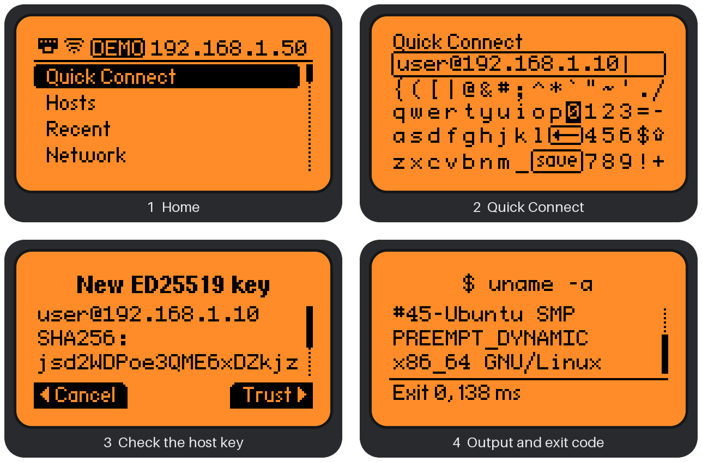
  <br>
  <sub>Shown in <a href="flipper-app/README.md#without-the-board">demo mode</a> with example data.</sub>
</p>

SSH Runner pairs a Flipper Zero app with firmware for an ESP32-S3 board that has a W5500
Ethernet port. The board handles networking and cryptography (libssh); the Flipper is the
keyboard and screen. Pick a host, authenticate, run a command or a script, and read the output.

**Contents:** [Features](#features) · [Screenshots](#screenshots) · [Hardware](#hardware) ·
[Installation](#installation) · [Usage](#usage) · [Documentation](#documentation) ·
[Building From Source](#building-from-source) · [Security](#security) · [Roadmap](#roadmap) ·
[Contributing](#contributing) · [License](#license) · [Acknowledgments](#acknowledgments)

## Features

- **Wired or wireless:** LAN (W5500 Ethernet) and 2.4 GHz WiFi, DHCP or static, with automatic
  fallback between them.
- **Password or key authentication:** Ed25519, ECDSA and RSA keys from the SD card, or keys
  generated by the app; an encrypted key needs its passphrase only once.
- **Host-key pinning** per host: prompt, strict or off.
- **Commands your way:** one-liners, saved commands per host or global, and shell scripts from
  the SD card.
- **Readable output** with the exit code and run time; very long output keeps its beginning and end.
- **Ready to try:** built-in example commands and a system-info script.
- **PC companion:** `sshrunner` edits hosts, commands, keys and scripts over USB, with backups
  before every change.
- **Optional secret protection:** encrypt the board's stored credentials with an eFuse key.

## Screenshots

<p align="center">
  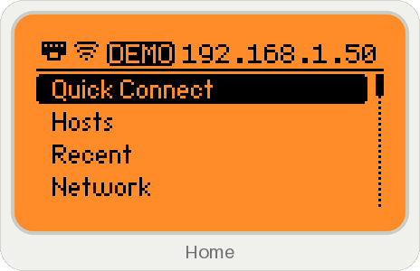
</p>

Every screen below is from the app's [demo mode](flipper-app/README.md#without-the-board)
(simulated board, example data), at 4× the Flipper's 128×64 screen.

<table>
<tr>
<td width="33%"><br><sub><b>Hosts:</b> saved hosts by name</sub></td>
<td width="33%">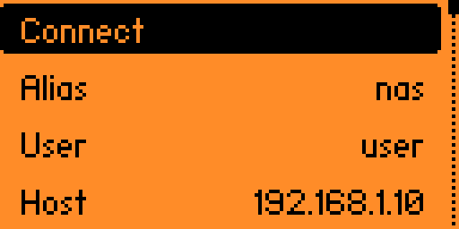<br><sub><b>Host page:</b> user, address, auth, commands</sub></td>
<td width="33%">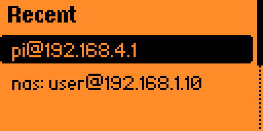<br><sub><b>Recent:</b> the last connections</sub></td>
</tr>
<tr>
<td>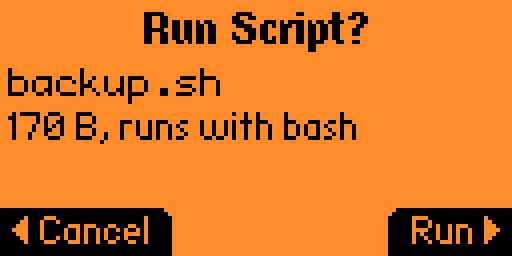<br><sub><b>Scripts:</b> name, size and shell shown first</sub></td>
<td>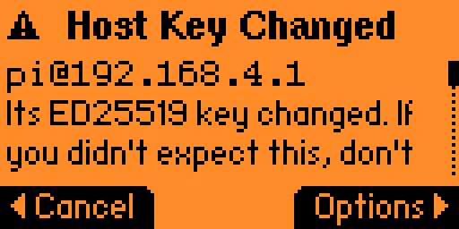<br><sub><b>Host key changed:</b> a warning, never a silent connect</sub></td>
<td>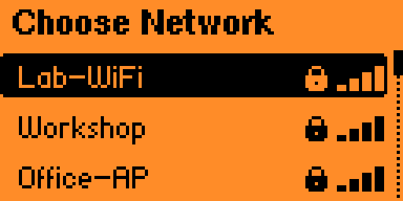<br><sub><b>WiFi:</b> scan and join from the Flipper</sub></td>
</tr>
<tr>
<td>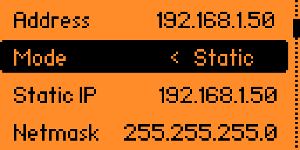<br><sub><b>LAN:</b> DHCP or a static address</sub></td>
<td>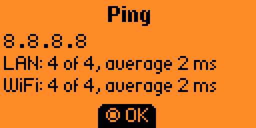<br><sub><b>Ping:</b> through LAN and WiFi</sub></td>
<td>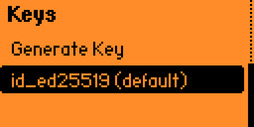<br><sub><b>Keys:</b> generate or import</sub></td>
</tr>
<tr>
<td>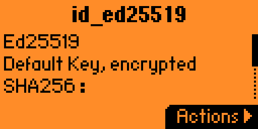<br><sub><b>Key details:</b> type, passphrase, fingerprint</sub></td>
<td><br><sub><b>Settings:</b> restore the built-in examples</sub></td>
<td>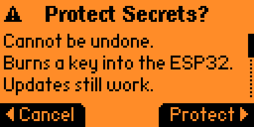<br><sub><b>Security:</b> optional secret protection</sub></td>
</tr>
</table>

<p align="center">
  <br>
  <b>The PC tool:</b> <code>sshrunner</code> edits hosts, commands, keys and scripts from a computer (<a href="cli/README.md">PC Tool</a>)
</p>

## Hardware

| Part | Notes |
|---|---|
| Flipper Zero | Unleashed `unlshd-094` or official `1.5.1` firmware, with an SD card |
| [Waveshare ESP32-S3-ETH](https://www.waveshare.com/wiki/ESP32-S3-ETH) | ESP32-S3R8, 16 MB flash, W5500 Ethernet with RJ45, USB-C |
| 3–4 jumper wires | see the wiring below |
| Ethernet cable or a 2.4 GHz WiFi network | the ESP32-S3 has no 5 GHz radio |

### Wiring

| Flipper Zero GPIO | ESP32-S3-ETH | Use |
|---|---|---|
| 13 (TX) | GPIO18 (header H1 pin 10) | always |
| 14 (RX) | GPIO17 (header H1 pin 7) | always |
| 8, 11 or 18 (GND) | GND | always |
| 9 (3V3) | 3V3 header pin | portable use |

- **Desk use:** three wires; the board is powered from its own USB-C.
- **Portable use:** add a wire from the Flipper's GPIO header pin 9 (3V3) to the board's 3V3
  pin; the board then runs from the Flipper's battery, with no USB-C cable.

> [!WARNING]
> Never plug in the board's USB-C while the 3V3 wire is connected: that ties two power
> supplies together. Remove the 3V3 wire before connecting USB-C (for example to flash the
> firmware). Leave "5V on GPIO" off on the Flipper.

Pin details: [Hardware and Wiring](docs/HARDWARE.md). A custom add-on PCB that plugs straight into
the Flipper is coming in a later release.

<table>
<tr>
<td width="50%" align="center">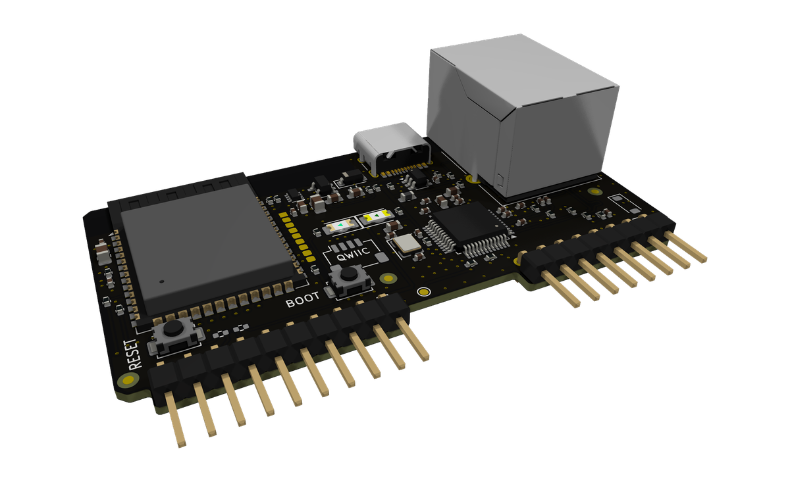</td>
<td width="50%" align="center">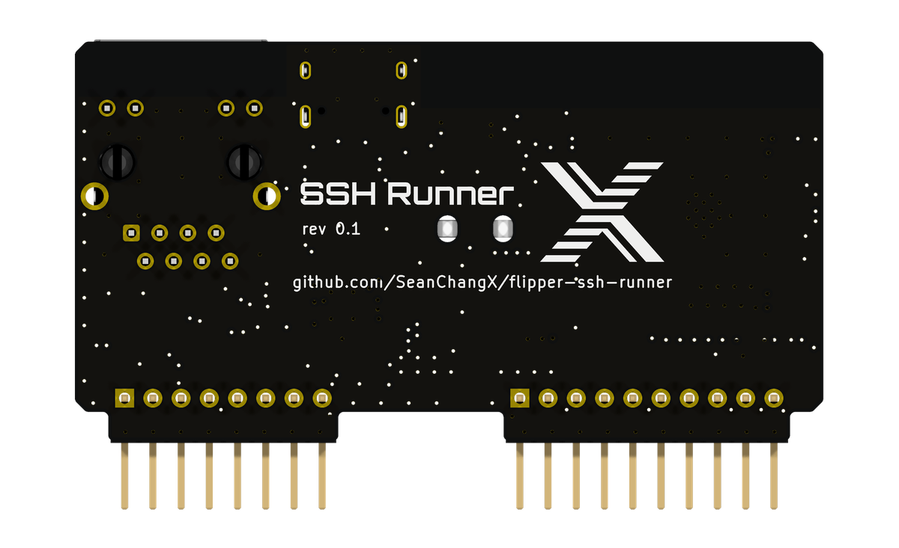</td>
</tr>
</table>

<p align="center">SSH Runner rev 0.1, the custom add-on PCB: in production; design files will be
published with v0.3.0 after bring-up.</p>

## Installation

Download the files from the [latest release](https://github.com/SeanChangX/flipper-ssh-runner/releases/latest).

### Flipper App

Download the official build, `ssh_runner-official.fap`: it runs on the official and on the
Unleashed firmware. Copy it to `SD Card/apps/GPIO/` with qFlipper or a card reader, and open it
from **Apps > GPIO > SSH Runner**. `ssh_runner-unleashed.fap` is optional, for Unleashed only
(it scrolls long values in lists instead of showing their end).

If the Flipper reports an API mismatch or an outdated app after a firmware update, download
the latest release. A Flipper app runs when its API major version equals the firmware's and
its minor version is not newer. The official build targets API 88.2, which the official
firmware `1.5.1` (88.2) and Unleashed `unlshd-094` (88.19) both accept.

### ESP32 Firmware

Unzip `flipper-ssh-runner-esp32-v<version>.zip` and connect the board's USB-C (3V3 wire
removed). The simplest way is in the browser, with Spacehuhn's
[ESPTool](https://esptool.spacehuhn.com/) in desktop Chrome or Edge: the three parts at
offsets `0`, `8000` and `20000`, step by step in the
[Quick Start](docs/QUICKSTART.md#in-the-browser-recommended). Or with
[esptool](https://github.com/espressif/esptool):

```sh
esptool.py --chip esp32s3 -p <port> write_flash @flash_args
```

On a first install, erase the flash first (**Erase** in the browser, or `esptool.py --chip
esp32s3 -p <port> erase_flash`). On an update, do not erase and do not merge the parts into one
image at offset `0x0`: flashing the three parts keeps the board's saved WiFi network and trusted
host keys. The firmware burns no eFuses unless you enable secret protection in the app.

### PC Tool (optional)

Archives for Linux, macOS and Windows (`sshrunner_<version>_<os>_<arch>`), plus `.deb` and
`.rpm` packages. See [cli/README.md](cli/README.md).

## Usage

1. Wire the board to the Flipper and power it (USB-C, or the 3V3 wire).
2. Open **SSH Runner**. The header shows the board's address once it has a network.
3. **Network > LAN:** plug in an Ethernet cable, or **Network > Join WiFi** to pick a network.
4. **Quick Connect:** type `user@host`, check the host key, enter the password.
5. Pick a command, or type one, and read the output. Save the host to reuse it.

Step by step, with what each message means: [docs/QUICKSTART.md](docs/QUICKSTART.md).

## Documentation

| Document | What it covers |
|---|---|
| [Quick Start](docs/QUICKSTART.md) | Wiring, flashing, installing, the first connection, messages |
| [Hardware and Wiring](docs/HARDWARE.md) | Pin assignments, desk and portable power |
| [PC Tool (`sshrunner`)](cli/README.md) | Editing the Flipper's hosts, commands, keys and scripts from a computer |
| [Flipper App](flipper-app/README.md) | Screens, SD card files, examples, demo mode, compatibility |
| [Architecture](docs/ARCHITECTURE.md) | Repository layout and build outputs |
| [UART Protocol](docs/PROTOCOL.md) | The link between the Flipper and the board |
| [Security](docs/SECURITY.md) | Stored secrets, secret protection, host keys, wiping |
| [Changelog](CHANGELOG.md) | Changes in each release |
| [Contributing](CONTRIBUTING.md) | Issues, pull requests, running the checks |
| [Third-Party Components](THIRD_PARTY.md) | Components and their licenses |

All documents, grouped: [docs/README.md](docs/README.md).

## Building From Source

Requirements: [Docker](https://docs.docker.com/get-docker/) (the ESP-IDF, uFBT and Go
toolchains run in pinned containers or a local Python venv; nothing is installed globally) and
Python 3.

```sh
# Linux / WSL
tools/check.sh
```

```powershell
# Windows (PowerShell)
python -m venv venv
venv\Scripts\pip install --cache-dir .cache\pip -r requirements.txt
powershell -ExecutionPolicy Bypass -File tools\check.ps1
```

This builds the Flipper app for both firmwares, the ESP32 firmware and the PC tool, and runs
the tests. Repository layout: [docs/ARCHITECTURE.md](docs/ARCHITECTURE.md); UART protocol:
[docs/PROTOCOL.md](docs/PROTOCOL.md).

## Security

The board stores WiFi credentials, remembered passwords and trusted host keys in its flash,
unencrypted by default. **Settings > Security > Protect Secrets** encrypts them with a key
burned into an eFuse; this cannot be undone. Private keys stay on the Flipper's SD card. Erase
the board (`esptool.py --chip esp32s3 -p <port> erase_flash`) before giving it away. Threat
model, details and how to report a vulnerability: [docs/SECURITY.md](docs/SECURITY.md).

## Roadmap

- Custom add-on PCB for the Flipper's GPIO header
- Several saved WiFi networks, joining whichever is in range
- Board status LED

## Contributing

Issues and pull requests are welcome. See [CONTRIBUTING.md](CONTRIBUTING.md) for how to report
a bug, run the checks and send a change.

## License

[GPL-3.0-only](LICENSE). Third-party components and their licenses:
[THIRD_PARTY.md](THIRD_PARTY.md).

## Acknowledgments

- [libssh](https://www.libssh.org/) and [LibSSH-ESP32](https://github.com/ewpa/LibSSH-ESP32) by Ewan Parker
- [Flipper Zero firmware](https://github.com/flipperdevices/flipperzero-firmware) and
  [Unleashed firmware](https://github.com/DarkFlippers/unleashed-firmware)
- [UART Terminal](https://github.com/cool4uma/UART_Terminal) by cool4uma, for the keyboard layout
- [Espressif ESP-IDF](https://github.com/espressif/esp-idf)
- [Charm](https://charm.sh/) (Bubble Tea, Bubbles, Lip Gloss) for the PC tool's interface
