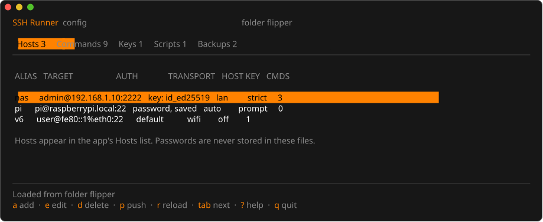
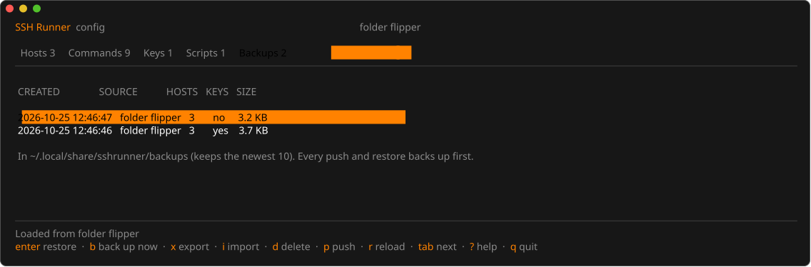
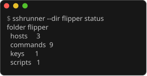
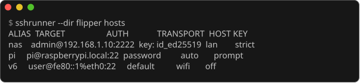
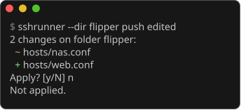
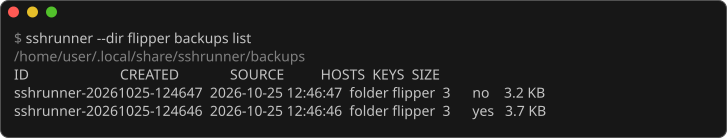

# sshrunner

[← Documentation index](../docs/README.md)

Manage SSH Runner's hosts, global commands, keys and scripts from a computer instead of the
Flipper's keyboard. `sshrunner` connects to the Flipper Zero over USB (the same RPC qFlipper
uses), or works on a folder: the SD card in a card reader, or a copy of it.

```text
sshrunner                     the interactive editor
sshrunner <command> [args]    one command, for scripts
```

## Contents

- [Install](#install)
- [The Editor](#the-editor)
- [Commands](#commands)
- [Safety](#safety)
- [Development](#development)

## Install

Download the archive for your system from the project's release page and put `sshrunner`
(`sshrunner.exe` on Windows) on your `PATH`; on Debian/Ubuntu or Fedora the `.deb` / `.rpm`
installs it to `/usr/bin`. The binaries are static: nothing else to install.

From source (Go, version in `go.mod`):

```sh
cd cli && go build -o sshrunner ./cmd/sshrunner
```

On Linux the Flipper's port needs the `dialout` group (`sudo usermod -aG dialout $USER`, then
log in again). Close qFlipper and leave the SSH Runner app (back to the Flipper's desktop)
while `sshrunner` is connected.

## The Editor

Running `sshrunner` with no arguments opens a terminal UI with one tab per kind of file. The
Hosts tab, on a folder (`--dir`):



| Key | Action |
|---|---|
| `tab`, `←` `→`, `1`-`5` | Hosts, Commands, Keys, Scripts, Backups |
| `↑` `↓` (`k` `j`) | select |
| `a` / `e`, `enter` / `d` | add / edit / delete (hosts, commands) |
| `i` | import a private key (its `.pub` next to it comes too) or add a `.sh` script |
| `tab` in a file field | complete the path like a shell; a second `tab` lists the matches (`↑` `↓`, `enter` takes one) |
| `ctrl+o` in a file field | browse: folders and only the files that fit (keys `id_*` / `*.pem`, scripts `*.sh`, backups `.zip` / `.tar.gz`); type to filter, `backspace` goes up |
| `J` `K` | move a global command down / up |
| `p` | push: shows every change, asks, backs up, writes, checks each file |
| `r` | reload from the Flipper |
| `q` | quit (asks when there are unpushed changes) |
| `?` | every key of the current tab |
| mouse | click a tab, a row or a key hint (also a dialog's `y yes` / `n no`); the wheel scrolls. `--no-mouse` (or `mouse = false`) turns it off; Shift+drag selects text in most terminals either way |

Text fields stop at the app's limits (a command 127 characters, a host 63, a user 32) and show
`used/limit` once 80% full. A file with a longer command, or more than the app holds, is
refused with the reason (`hosts/nas.conf: command 2: 128 characters, at most 127`), never
cut: in the editor it is listed as left as it is.

### Backups Tab

Every backup in the backup folder (shown under the list), newest first: when it was made,
from where, how many hosts, whether it holds private keys, and its size.



| Key | Action |
|---|---|
| `enter` | restore it to the Flipper: shows every change first, backs up the current state, then writes |
| `b` | back up now, private keys included (`k` in the dialog leaves them out) |
| `x` | export it as one `.zip` or `.tar.gz` file (a warning when it holds private keys) |
| `i` | import an exported file: checked first (one sshrunner backup, every file in its manifest with the right SHA-256, no links, no paths outside it) |
| `d` | delete it (asks; `enter` answers no) |

Edits stay on the computer until you push. The editor checks them with the app's own rules:
an alias the app would refuse, a host on a key that is not there, or too many commands cannot
be pushed.

## Commands

```sh
sshrunner status                  # what is on the Flipper
sshrunner hosts                   # the hosts, one per line
sshrunner pull ./flipper          # copy hosts, commands, scripts and public keys to ./flipper
sshrunner push ./flipper          # write them back, showing the changes first
sshrunner push ./flipper --delete # ... and remove hosts and scripts ./flipper no longer has
sshrunner import-key ~/.ssh/id_ed25519
sshrunner backup                  # the whole data folder, private keys included
sshrunner backup --no-keys        # ... without the private keys
sshrunner restore <backup>        # a backup's ID (from `backups list`) or its folder
sshrunner backups list            # the backups, newest first
sshrunner backups export <id> backup.zip   # one file to keep or move (.zip or .tar.gz)
sshrunner backups import backup.zip        # checked, then listed like the others
sshrunner backups delete <id>
```

Long steps (push, pull, backup) show `[12/30] hosts/nas.conf` on one line while they run, in a
terminal only, then the summary.




A push lists every change first (`~` changed, `+` added, `-` removed with `--delete`) and asks:




These screens come from `tools/cli_figures.py`, which runs `sshrunner` on demo data.

A pulled folder holds each key's `.pub` but not its private file, which stays on the Flipper.
Such a key counts as a key ("public key" in the Keys tab, `keys_public_only` in `status
--json`), hosts may use it, and a push never writes or deletes the private file. A push refuses
a host whose key's private file is neither in the folder nor on the Flipper.

### JSON

`status`, `hosts` and `backups list` print JSON with `--json`, for scripts. The field names stay
stable:

```sh
sshrunner status --json        # {"source", "hosts", "commands", "keys", "keys_public_only", "scripts",
                               #  "unreadable"}
sshrunner hosts --json         # [{"alias", "user", "host", "port", "auth", "key", "save_password",
                               #   "transport", "host_key_policy", "commands"}]
sshrunner backups list --json  # {"dir", "backups": [{"id", "created", "source", "hosts", "keys", "files", "size"}]}
```

### Shell Completion

`sshrunner completion <shell>` prints a script that completes commands, flags, backup IDs and
paths:

```sh
sshrunner completion bash > ~/.local/share/bash-completion/completions/sshrunner
sshrunner completion zsh > "${fpath[1]}/_sshrunner"        # then: compinit
sshrunner completion fish > ~/.config/fish/completions/sshrunner.fish
sshrunner completion powershell >> $PROFILE                # PowerShell
```

### Config File

Optional defaults in `config.toml`: `~/.config/sshrunner/` on Linux,
`~/Library/Application Support/sshrunner/` on macOS, `%AppData%\sshrunner\` on Windows
(`SSHRUNNER_CONFIG` names another file). Flags win over the environment, which wins over the
file:

```toml
port = "COM3"              # or "/dev/ttyACM0"
backup_dir = "~/sshrunner-backups"
keep_backups = 10          # 0 keeps all
mouse = true
```

An unknown key or a bad value stops sshrunner with the file's line number.

`--port <device>` picks a Flipper when more than one is connected; `--dir <folder>` works on a
folder instead of a Flipper; `--yes` applies without asking (for scripts).

The files are plain text: edit `hosts/<alias>.conf` and `commands.conf` in the pulled folder
with any editor, then push. A file the app could not read is refused before anything is
written.

## Safety

- Every push, restore and key import makes a backup first. Backups go to
  `~/.local/share/sshrunner/backups` (Linux), `~/Library/Application Support/sshrunner/backups`
  (macOS) or `%LOCALAPPDATA%\sshrunner\backups` (Windows); `--backup-dir` or
  `SSHRUNNER_BACKUP_DIR` changes it. Each backup has a manifest with every file's SHA-256, and a
  changed file is refused on restore.
- After each change only the newest 10 backups are kept; older ones are deleted, never the one
  just made, and nothing in the folder except sshrunner's own `sshrunner-<date>-<time>` backups.
  `--keep-backups <n>` (or `SSHRUNNER_KEEP_BACKUPS`) changes the number; `0` keeps them all.
- A backup is complete: it holds the private keys too, since a key made on the Flipper exists
  nowhere else (`--no-keys` leaves them out). The automatic backup before a push, restore or key
  import always holds them, so it brings back exactly what was there. Backups are written
  owner-only (files 0600, folders 0700; on Windows a protected ACL for you and SYSTEM only),
  and exporting one that holds private keys warns first.
- `pull` is an editing copy, not a backup: it leaves the private keys on the Flipper unless
  `--include-keys` is given.
- Only `hosts/`, `keys/`, `scripts/` and `commands.conf` are changed. The app's settings, recent
  list and saved output are never touched (a restore writes back the ones the backup holds).
- Nothing pushes while an app is running on the Flipper. Every file written over USB is read
  back by its MD5.
- There is no password field: passwords are kept on the board after the first login, never on
  the SD card.

## Development

```sh
go vet ./... && go test ./...     # also step "cli" of tools/check.sh
go test ./internal/tui -run Frames -update   # rewrite the editor's golden screens (internal/tui/testdata/frames)
scripts/package.sh                # archives and .deb/.rpm in ../.cache/cli-dist
```

The file formats are SSH Runner's (`flipper-app/core/profile.c`); `flipper-app/tests/golden/`
holds files the app and this tool both read and write back byte for byte, so the two cannot
drift apart. `internal/flipper` has an in-memory Flipper for tests.

## See Also

- [Flipper App](../flipper-app/README.md): the files `sshrunner` edits
- [Quick Start](../docs/QUICKSTART.md): setting up the board and the app
